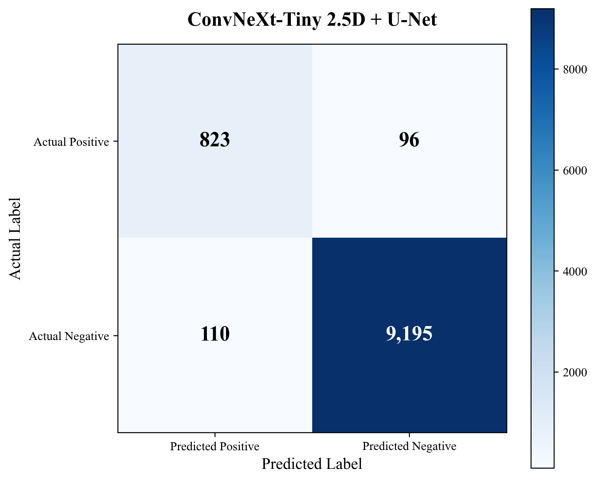
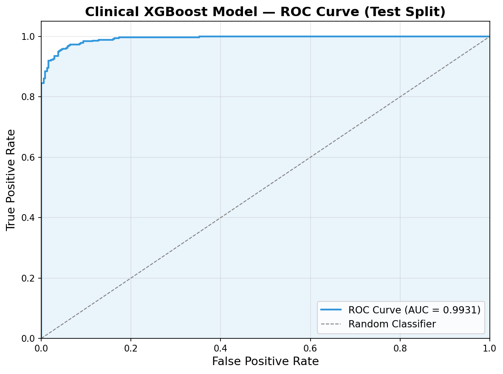
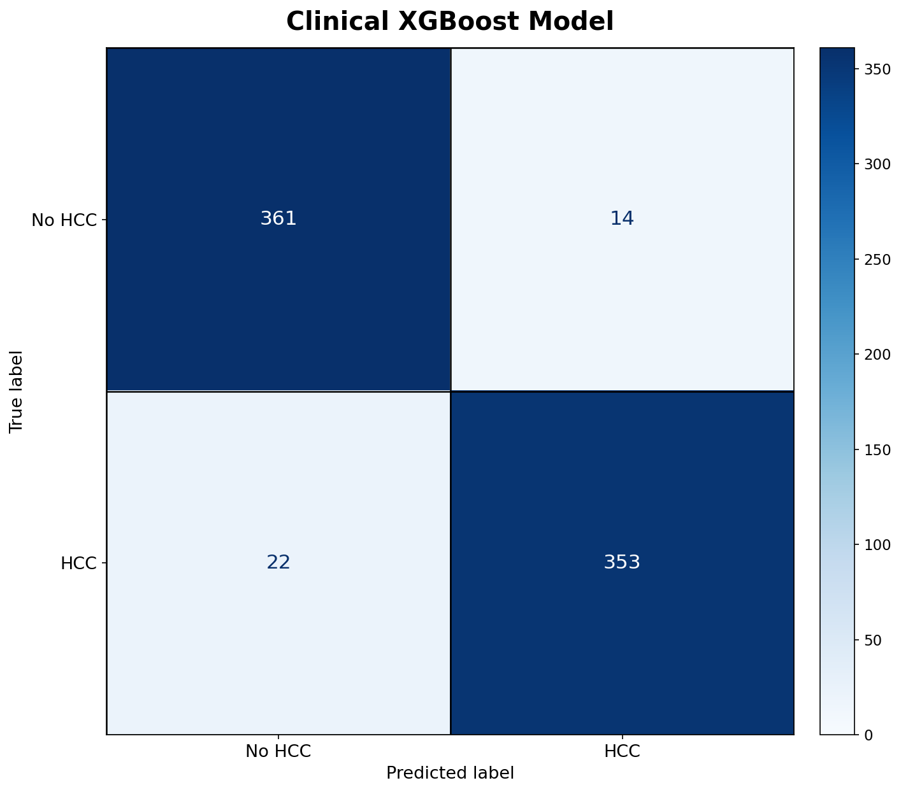
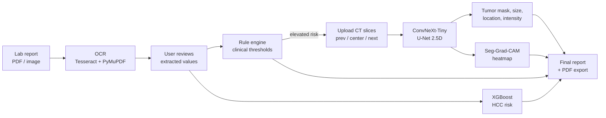

# Hybrid AI: Liver Cancer (HCC) Detection System

A hybrid clinical + CT decision-support system for **hepatocellular carcinoma (HCC)** that mirrors how a clinician works: screen the patient's **blood report** first, and only move to **CT imaging** when the lab markers point to elevated risk.

| Stage | What it does | Model / technique |
|---|---|---|
| 1. Blood report | OCR a lab report PDF/image, review the values, score HCC risk | Tesseract OCR + rule engine + **XGBoost** |
| 2. CT scan | Segment the liver tumor, measure it, explain the prediction | **ConvNeXt-Tiny U-Net (2.5D)** + **Seg-Grad-CAM** |
| 3. Report | Combine all results into one structured clinical report with PDF export | Report builder + print-ready PDF |

> For research and educational use only. Not a medical device. The clinical (lab) dataset is synthetic.

---

## Results

### CT tumor segmentation: ConvNeXt-Tiny 2.5D + U-Net

Trained on the **full LiTS dataset** (131 CT volumes, 58,638 slices) and evaluated on **19 held-out test volumes (10,224 slices)** that the model never saw during training or model selection.

| Metric | Test score |
|---|---|
| **Dice coefficient** | **0.8888** |
| IoU (Jaccard) | 0.7998 |
| Precision | 0.882 |
| Recall / Sensitivity | 0.896 |
| Accuracy | 0.9799 |

Dice and IoU measure pixel overlap between the predicted and true tumor masks. Precision, recall and accuracy come from the slice-level confusion matrix (does a slice contain tumor or not). Source: [`backend/outputs/metrics/segmentation_metrics.txt`](backend/outputs/metrics/segmentation_metrics.txt).

<p align="center">
  
</p>

### Clinical risk model: XGBoost

Evaluated on a held-out test split of **750 patients** from the 5,000-patient synthetic cohort.

| Accuracy | Precision | Recall / Sensitivity | Specificity | F1 | ROC-AUC |
|---|---|---|---|---|---|
| 0.9520 | 0.9619 | 0.9413 | 0.9627 | 0.9515 | **0.9931** |

Source: [`backend/outputs/metrics/clinical_metrics.txt`](backend/outputs/metrics/clinical_metrics.txt).

<p align="center">
  
  
</p>

---

## Architecture



**Backend:** FastAPI serves both models, OCR and report generation. **Frontend:** React 19 + Vite, a guided 3-step workflow with a decision-tree viewer for the XGBoost model and a printable A4 report.

---

## Key design decisions

These are the parts of the project worth discussing in detail.

**1. Volume-level data split (no leakage).**
Neighbouring CT slices from one patient are nearly identical. Splitting LiTS by slice would put almost-duplicate images in both train and test and inflate the scores. The split is therefore done on **whole CT volumes** (70/15/15, stratified by whether a volume contains tumor): 92 train, 20 validation and 19 test volumes. The split is saved to `outputs/splits/segmentation_split.json` and reused on every run. `verify_split_integrity()` checks that no volume appears in two splits.

**2. 2.5D input instead of 2D or 3D.**
Each input stacks the **previous, current and next slice** as the 3 channels. This gives the model context across slices (tumors span several slices) while keeping the 3-channel input of an ImageNet-pretrained ConvNeXt, so pretrained weights can be used without changing the architecture. It costs far less memory than a full 3D network.

**3. Loss function built for small, imbalanced targets.**
Tumor pixels are a tiny fraction of each slice. The loss is **BCE (with `pos_weight`) + Tversky (α = 0.3, β = 0.7)**. Because β > α, missed tumor pixels cost more than false alarms, which pushes recall up.

**4. Training on a laptop GPU.**
Gradient accumulation (micro-batch 8 × 4 steps = effective batch 32), AdamW, ReduceLROnPlateau, early stopping on validation Dice, resumable checkpoints, and a BatchNorm fix for an Apple MPS backward-pass bug.

**5. Explainability for a segmentation model.**
Grad-CAM normally needs a class score. Here the target is the **sum of predicted tumor probabilities**. The CAM is taken from a 32×32 encoder stage, not the deepest 8×8 one, because many LiTS tumors are smaller than one cell of the 8×8 map. It is then weighted by the predicted probability map so the heatmap stays on the lesion.

**6. Leakage-safe tabular pipeline.**
For XGBoost the data is split before preprocessing. Imputers, scaler and encoder are fit on the training split only, the grid search uses 5-fold CV inside the training split, and the test split is used once at the end. Missing OCR values are imputed by the trained preprocessor rather than guessed.

**7. The report only states what the models found.**
The report is built strictly from the structured outputs of the earlier stages (images removed), with fixed sections: Patient Summary, Clinical Findings, Clinical Risk Model, Imaging Findings, Impression and Recommendations. No new analysis happens at this step, and a built-in template guarantees a complete report even when the external writing service is not configured.

---

## Tech stack

| Area | Tools |
|---|---|
| Deep learning | PyTorch, segmentation-models-pytorch, timm (ConvNeXt-Tiny) |
| Classical ML | XGBoost, scikit-learn, pandas |
| Imaging / OCR | OpenCV, Pillow, Tesseract (pytesseract), PyMuPDF |
| Reporting | Gemini API (`google-genai`, optional), browser print-to-PDF |
| API | FastAPI, Uvicorn, Pydantic |
| Frontend | React 19, Vite, Tailwind CSS, framer-motion, three.js |

---

## Repository structure

```text
.
├── backend/
│   ├── app/                         FastAPI application
│   │   ├── main.py                  app entry point, loads models at startup
│   │   ├── routes.py                API endpoints
│   │   ├── schemas.py               request / response models
│   │   ├── blood_report.py          OCR, value parsing, rule engine
│   │   └── report_generator.py      final report builder
│   ├── src/
│   │   ├── lits_dataset.py          LiTS indexing, volume-level split, 2.5D dataset
│   │   ├── segmentation_model_convnext.py   ConvNeXt-Tiny U-Net + losses
│   │   ├── segmentation_inference.py        mask, measurements, overlays
│   │   ├── gradcam.py               Seg-Grad-CAM
│   │   ├── clinical_xgb_data.py     clinical features, split, preprocessing
│   │   ├── clinical_xgb_model.py    XGBoost + CV grid search
│   │   ├── clinical_xgb_inference.py
│   │   ├── generate_hcc_xgboost_dataset.py  synthetic clinical cohort
│   │   └── generate_hcc_lab_reports.py      synthetic lab report PDFs
│   ├── outputs/
│   │   ├── metrics/                 test-set metrics
│   │   ├── plots/                   evaluation plots
│   │   ├── models/                  XGBoost model (CNN weights not in git)
│   │   └── splits/                  saved train/val/test splits
│   ├── tests/
│   ├── train_segmentation_convnext.py
│   ├── train_clinical_xgb.py
│   └── requirements.txt
├── frontend/                        React + Vite UI
├── samples/                         demo cases (lab report + 3 adjacent CT slices)
│   ├── case_hcc/
│   └── case_no_hcc/
└── run_app.bat                      starts backend and frontend on Windows
```

---

## Running locally

### Prerequisites
- Python 3.10+ and Node.js 18+
- [Tesseract OCR](https://github.com/UB-Mannheim/tesseract/wiki) on `PATH` (or set `TESSERACT_CMD` in `backend/.env`)
- The trained segmentation checkpoint `best_segmentation_convnext_model.pth` in `backend/outputs/models/`. At about 380 MB it is over GitHub's file size limit, so it is not committed; train it (see below) or get it from the GitHub Release where it is published.

### Backend
```bash
cd backend
python -m venv .venv
.venv\Scripts\activate            # Windows   (macOS/Linux: source .venv/bin/activate)
pip install -r requirements.txt
copy .env.example .env            # optional: GEMINI_API_KEY for report writing
uvicorn app.main:app --host 127.0.0.1 --port 8000
```
API docs: http://localhost:8000/docs

### Frontend
```bash
cd frontend
npm install
npm run dev
```
Open http://localhost:5173. On Windows, `run_app.bat` starts both.

### Try it
Use a folder in [`samples/`](samples): upload the `lab_report_*.pdf`, then upload three consecutive `volume-<id>_<n>.png` slices as previous / center / next.

---

## Training

### Segmentation (full LiTS)
1. Download [LiTS PNG](https://www.kaggle.com/datasets/andrewmvd/lits-png) and extract it to `backend/data/lits_png/`.
2. Train:
   ```bash
   cd backend
   python train_segmentation_convnext.py
   ```
   This writes checkpoints to `outputs/models/`, metrics to `outputs/metrics/segmentation_metrics.txt` and plots to `outputs/plots/`. Hyperparameters are in the `CONFIG` dict at the top of the script; set `resume_from` to continue an interrupted run.

### Clinical model
```bash
cd backend
python -m src.generate_hcc_xgboost_dataset     # creates data/hcc_xgboost/hcc_synthetic_dataset.xlsx
python train_clinical_xgb.py
```

### Tests
```bash
cd backend
pip install -r requirements-dev.txt
python -m pytest tests/ -q
```

---

## API

| Method | Endpoint | Description |
|---|---|---|
| GET | `/` | Health check and model status |
| POST | `/blood/extract` | OCR a lab report: markers, demographics, model features |
| POST | `/blood/assess` | Rule-based triage and CT recommendation |
| POST | `/clinical/predict` | XGBoost HCC risk probability |
| GET | `/clinical/tree/{index}` | Export one XGBoost tree as JSON |
| POST | `/segment` | Segment a single CT slice |
| POST | `/analyze` | 2.5D segmentation from previous / center / next slices |
| POST | `/report/generate` | Build the final report |

---

## Limitations

- The clinical dataset is **synthetic** (based on published marker thresholds), so the XGBoost scores show the pipeline works but say nothing about real-world clinical accuracy.
- LiTS PNGs contain no DICOM pixel spacing, so millimetre measurements use an assumed spacing and are approximate. Intensities are grayscale values, not Hounsfield Units.
- Segmentation is per slice (2.5D); there is no 3D volume reconstruction.

## Dataset credit

Bilic et al., *The Liver Tumor Segmentation Benchmark (LiTS)*, Medical Image Analysis, 2023. PNG version: [andrewmvd/lits-png](https://www.kaggle.com/datasets/andrewmvd/lits-png).
